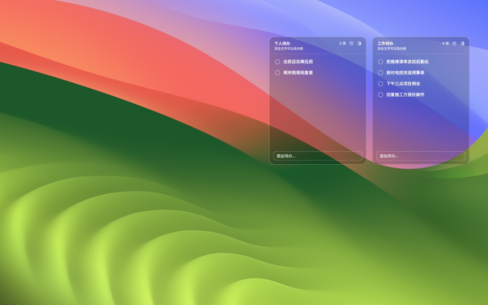

# 桌面待办 · Desktop Todo

贴在 macOS 桌面上的两个待办清单。窗口位于**壁纸之上、所有普通窗口之下**，
不占 Dock、不进 Mission Control、不抢焦点——打开任何 App 它就消失，回到桌面它就在。

A pair of todo lists that live on your macOS desktop, **above the wallpaper and
below every window**. No Dock icon, no Mission Control, no focus stealing.



> 预览为合成示意：窗口截图叠加在系统壁纸（Sonoma）上，实际使用时背景就是你的桌面。

## 特点

- **桌面层**：不是浮在所有窗口之上的挂件，而是桌面的一部分
- **两个清单**：工作待办 / 个人待办，各自独立的数据、收录本、位置
- **透明玻璃**：无底板，只有边缘一圈毛玻璃；另有黑玻璃主题，点一下切换，记住选择
- **勾掉即收录**：完成的任务自动进入「已完成收录」，记录完成时间，30 天自动清理
- **点击恢复**：收录里点勾号即可把任务拿回待办
- **贴边吸附**：靠近屏幕边缘或另一个清单时，松手后缓动吸附，并对齐像素
- **接缝处理**：两个清单贴住时自动抹平接缝处圆角，毛玻璃描边也一起对齐
- **可选锁链**：贴住时接缝上出现小锁，锁定后拖动一个两个一起走（内容仍各自独立）
- **数据可靠**：原子写 + 上一版 `.bak` + 坏文件留证并自动恢复
- **单实例**：重复启动不会产生两个实例互相覆盖数据

## 安装

需要 macOS 13+、Xcode 命令行工具。

```bash
git clone <this-repo>
cd desktop-todo
./build.sh
```

把生成的 `桌面待办.app` 拖到 `~/Applications` 或 `/Applications`，双击运行。
菜单栏会出现 ☑️ 图标，里面有「开机自动启动」。

首次启动如果没看到它：按 **F11** 回到桌面。

## 用法

| 操作 | 效果 |
| --- | --- |
| 点左侧圆圈 | 完成任务，自动移入「已完成收录」 |
| 双击文字 | 行内编辑，回车保存 / Esc 取消 |
| 悬停某行 | 行尾出现 ×，单条删除 |
| 底部输入 + 回车 | 添加待办 |
| 右上角图标 | 归档（待办 ⇄ 收录）、切换外观 |
| 拖空白处 | 移动窗口，松手吸附 |
| 右下角斜纹 | 拖拽改大小 |

## 数据

`~/Library/Application Support/TodoFloat/`

- `work.json` / `work-archive.json`：工作待办与其收录
- `personal.json` / `personal-archive.json`：个人待办与其收录
- 每个文件旁边有 `.bak`（只保留一份）；解析失败时坏文件改名为 `.bad-时间戳` 留证

## 设计

实现细节、窗口层级、视觉参数、交互决策都写在 [DESIGN.md](DESIGN.md)。

## 已知限制

- 清单位于桌面图标之上，壁纸里的图标会透过透明卡片显示
- 收录列表为单行截断（右侧显示完成时间）
- 仅支持 Apple Silicon（arm64），最低 macOS 13

## License

MIT
